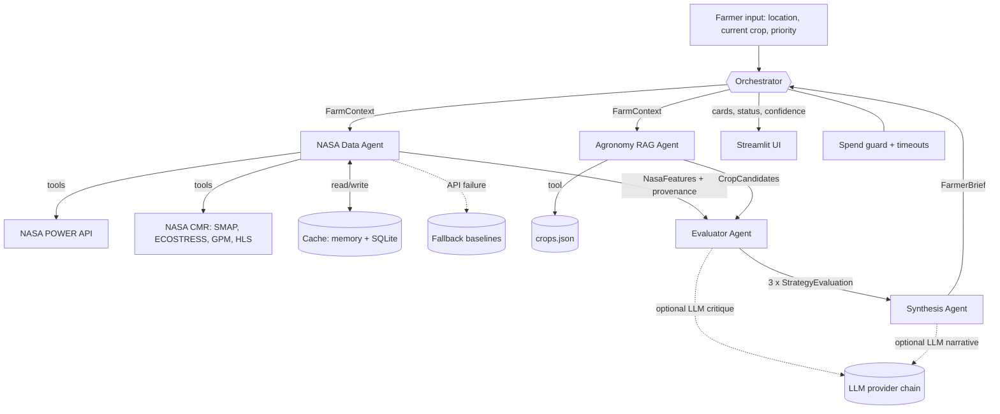

# FieldShift Maestro: Development Plan

*NASA Space Apps Challenge 2026, "Field Shift: Adapting Farms with NASA Data"*
*Tagline: **Conduct your next season.***

FieldShift Maestro is a farmer decision-support tool. An **orchestrator** conducts a small ensemble of agents. They fetch live NASA Earth observations, look up agronomy knowledge, score three crop-rotation paths and explain the tradeoffs in plain language, with the uncertainty shown.

**Constraints that shape every decision below**
- Free services only. Hard cap of **$8** total for the MVP, including going live.
- Fast: cold analysis under 4 s, warm under 300 ms.
- The app must never fail because an API did. It degrades visibly instead.
- Manual approval: nothing is built until this document is approved. After that, each stage waits for approval.

> Items marked **(verify)** are facts that change over time, such as free-tier limits, prices and layer names. They get confirmed against live docs when the relevant stage is built, not assumed.

---

## 1. Product concepts

| # | Concept | Idea | Strength | Weakness |
|---|---|---|---|---|
| 1 | **Conversational agent + map overlay** | A farmer chats and sees NASA layers on a map. | Familiar and demos well. | The answer is one path, which breaks the "reveal tradeoffs" directive. The map shows pretty layers, not decisions. |
| 2 | **Multi-scenario simulator** | Three rotation paths are scored side by side on live data. | Directly meets "compare ≥3 paths", "make uncertainty visible" and "reveal tradeoffs". | A pure dashboard can feel cold to a farmer. |
| 3 | **AI farm co-pilot** | A proactive assistant that monitors a farm over time. | Strong long-term story. | Needs accounts, storage and a notification system. Too big for an MVP and a free budget. |

**Chosen: Concept 2 with a conversational explainer from Concept 1.** The core is the scenario simulator. A short chat box (the Synthesis Agent) explains the cards in plain language. The orchestrator is the product's identity: it conducts the agents and is where the "Maestro" name comes from. Concept 3 is future work.

**Farmer flow:** enter a location, current crop and priority (Water, Soil or Income). Within seconds, see data status, three rotation cards with scores and a confidence badge, and a plain-language summary. Satellite jargon stays under the hood, and a "How we know this" expander exposes it for anyone who wants it.

---

## 2. Multi-agent architecture

Agents are **plain async Python functions or classes with typed Pydantic messages**. There is no LangGraph or LangChain. That keeps the dependency footprint small, startup fast and the code easy to test, and nothing in the brief needs a framework.



**Run order (a small DAG):**
1. The orchestrator builds a `FarmContext` and starts the **NASA Data Agent** and the **RAG Agent** *concurrently*. The RAG Agent needs only the crop, not satellite data.
2. When both finish, the **Evaluator Agent** scores the three strategies.
3. The orchestrator returns the cards to the UI **immediately**.
4. The **Synthesis Agent** writes the narrative afterwards, and the UI fills it in when it arrives. It never blocks the cards.

**Message contracts**

| Message | Producer → Consumer | Contents |
|---|---|---|
| `FarmContext` | Orchestrator → NASA, RAG | lat, lon, current crop, priority, region id |
| `NasaFeatures` | NASA → Evaluator | feature values, anomalies, per-feature provenance and freshness, per-source status |
| `CropCandidates` | RAG → Evaluator | candidate crops for each of the three strategy slots, with profiles |
| `StrategyEvaluation` ×3 | Evaluator → Synthesis, UI | metric scores, total, per-metric confidence, review notes |
| `FarmerBrief` | Synthesis → UI | headline, per-strategy summary, caveats |

**Agent responsibilities**

| Agent | Deterministic work | LLM use (optional) | Cost |
|---|---|---|---|
| NASA Data Agent | Fetch, harmonize, compute anomalies, tag provenance, fall back | none | $0 |
| Agronomy RAG Agent | Tag/keyword retrieval, candidate selection | none | $0 |
| Evaluator Agent | Scoring, confidence, review flags | **Call 1:** a short critique that words the "verify locally" notes | tiny |
| Synthesis Agent | Template summary (the fallback) | **Call 2:** plain-language narrative and chat | tiny |
| Orchestrator | DAG control, state, timeouts, spend guard | none | $0 |

The LLM only ever sees compact structured objects (about 1–2k tokens), never raw API responses. That keeps cost low, keeps answers grounded in computed numbers and limits hallucination of figures.

---

## 3. Real-time NASA ingestion and data harmonization

### 3.1 Sources (all free, no API key)

| Need | Endpoint | Notes |
|---|---|---|
| Daily weather, precipitation, solar, root-zone wetness | NASA POWER daily point API: `https://power.larc.nasa.gov/api/temporal/daily/point` | Query params: `parameters`, `community=AG`, `latitude`, `longitude`, `start`, `end` (YYYYMMDD), `format=JSON`. Missing values are `-999` and must be masked. |
| Satellite pass availability | NASA CMR granule search: `https://cmr.earthdata.nasa.gov/search/granules.json` | Query params: `short_name`, `point=lon,lat`, `temporal=start,end`, `sort_key=-start_date`, `page_size`. |
| NDVI map layer | NASA GIBS WMTS tiles | Layer name and tile path **(verify)**. Tiles only, no per-pixel values. |

**POWER parameters (verify exact names at build time):** `PRECTOTCORR` (precipitation, IMERG/GPM-based), `T2M`, `T2M_MAX`, `T2M_MIN`, `RH2M`, `WS2M`, `ALLSKY_SFC_SW_DWN`, `GWETROOT` (root-zone wetness, MERRA-2), `GWETTOP` (surface wetness, MERRA-2).

**CMR collections (verify short names and versions):** SMAP L3 soil moisture (`SPL3SMP_E`), ECOSTRESS gridded land-surface temperature (`ECO_L2T_LSTE`), GPM IMERG daily (`GPM_3IMERGDL`), HLS Landsat (`HLSL30`).

### 3.2 An honest data model

The challenge names SMAP, ECOSTRESS, GPM and Landsat/MODIS. Downloading their pixel data requires an Earthdata login and heavy file handling, which does not fit a fast, free MVP. The MVP therefore does this, and the UI says so:

| Quantity | What we actually use | Provenance tag |
|---|---|---|
| Precipitation | POWER `PRECTOTCORR` (GPM IMERG-based) | `live` |
| Root-zone / surface soil moisture | POWER `GWETROOT`/`GWETTOP` (MERRA-2 modeled) | `modeled` |
| Is there fresh SMAP data for this field? | CMR: latest granule age and count | `live` (availability only) |
| Is there fresh ECOSTRESS data? | CMR: latest granule age and count | `live` (availability only) |
| Vegetation | GIBS NDVI tiles (visual), HLS granule availability | `live` (visual / availability only) |
| Temperature, solar, humidity, wind | POWER | `live` |
| Anything unreachable | `data/regional_baselines.json` | `fallback` |

Real SMAP and ECOSTRESS pixel ingestion is listed as future work (section 9), and the architecture leaves a clean slot for it: the NASA Data Agent already tags provenance per feature.

### 3.3 Fetch strategy
- **One POWER request per location**, asking for all parameters over the last 90 days. Climatology (10 years) is loaded from the cache or from precomputed files. It is not fetched per request.
- **CMR queries run concurrently** with `asyncio.gather` (four small requests).
- Each request has a 5–6 s timeout and one retry with backoff. A `429` (rate limit) is treated as a failure, so the agent falls back and does not hammer the API.
- A missing layer (empty CMR result, or all `-999`) yields `unavailable` for that feature. It does not crash the pipeline.

### 3.4 Harmonization math

Sources have different grids and revisit times: POWER about 0.5° daily, SMAP about 9 km every 2–3 days **(verify)**, IMERG about 0.1° daily, ECOSTRESS about 70 m irregular, HLS 30 m every few days. The farm is a **point**. Everything is aligned to one **daily point time series** on the farm coordinate.

**Spatial alignment** (when a source gives several cells near the point), inverse-distance weighting over the 4 nearest cells:

$$v(p)=\frac{\sum_{j=1}^{4} w_j v_j}{\sum_{j=1}^{4} w_j},\qquad w_j=\frac{1}{d_j^{2}+\varepsilon}$$

**Representativeness uncertainty.** A coarse cell is a weaker description of a small farm, so variance is inflated with the cell size relative to the field:

$$\sigma^{2}_{\text{total}}=\sigma^{2}_{\text{meas}}+\sigma^{2}_{\text{repr}},\qquad \sigma_{\text{repr}}=\kappa\,\log\!\left(\frac{\Delta_{\text{grid}}}{\Delta_{\text{field}}}\right)$$

with κ calibrated per variable (initial values are documented defaults, not measured).

**Temporal alignment.** Sparse sources are carried forward with exponential decay:

$$\hat{x}_t=\alpha\,x_t+(1-\alpha)\,\hat{x}_{t-1}$$

and their weight decays with age:

$$w_{\text{fresh}}=\exp\!\left(-\frac{\text{age}_{\text{days}}}{\tau}\right)$$

with τ set per source (for example short for precipitation, longer for NDVI).

**Aggregation windows.** 7-day, 30-day and 90-day sums (precipitation) or means (temperature, wetness).

**Anomalies.** Each windowed feature is compared with the 10-year climatology of the same calendar window:

$$z=\frac{x-\mu_{\text{clim}}}{\sigma_{\text{clim}}}$$

A z-score above roughly +1 or below −1 is flagged ("wetter than usual", "drier than usual").

**Evapotranspiration.** Reference ET₀ uses Hargreaves–Samani, which needs only temperature and latitude and therefore always works with POWER:

$$ET_0=0.0023\,(T_{\text{mean}}+17.8)\sqrt{T_{\max}-T_{\min}}\;R_a$$

where $R_a$ is extraterrestrial radiation computed from latitude and day of year. Crop water use is then $ET_c = K_c \cdot ET_0$.

**Output:** a single `NasaFeatures` object. Each feature carries `value`, `z`, `provenance` (`live`, `modeled` or `fallback`), `age_days` and `weight`.

---

## 4. Agronomy RAG knowledge schema

"RAG" here is lightweight and free: structured JSON with tag and keyword scoring. There is **no vector database or embedding service**, which would add cost and latency for a few dozen entries.

```jsonc
// data/crops.json: one entry per crop
{
  "id": "cowpea",
  "name": "Cowpea",
  "role": ["nitrogen_fixer", "cover_crop", "cash_crop"],      // retrieval tags
  "rooting_depth_m": 1.2,
  "kc": { "initial": 0.4, "mid": 1.05, "late": 0.55 },        // FAO-56-style coefficients
  "season_water_mm": 400,                                     // approximate seasonal ETc
  "drought_tolerance": 0.8,                                    // 0..1
  "n_fixation_kg_ha": 60,                                      // typical, with min/max range
  "n_fixation_range": [30, 100],
  "residue_biomass_t_ha": 2.5,
  "ground_cover_off_season": 0.7,                              // 0..1 canopy/residue cover
  "pest_cycle_breaks": ["cereal_stem_borer", "root_knot_nematode"],
  "follows_well": ["maize", "sorghum", "wheat"],
  "avoid_after": ["cowpea", "bean"],
  "econ": { "margin_usd_ha": 350, "cost_usd_ha": 180, "price_volatility": 0.35 },
  "climate_notes": "Heat tolerant, poor on waterlogged soil.",
  "needs_local_verification": ["variety", "planting_window", "market_access"],
  "source": "FAO / extension summary (to be cited per entry)"
}
```

```jsonc
// data/regional_baselines.json: fallback climatology and soils per preset region
{
  "id": "punjab_pk",
  "lat": 31.0, "lon": 73.0,
  "monthly_precip_mm": [..12 values..],
  "monthly_tmean_c": [..12 values..],
  "monthly_soil_wetness": [..12 values..],
  "typical_soil": "loam",
  "erosion_prior": 0.3,
  "provenance": "approximate regional table (fallback only)"
}
```

**Retrieval (Agronomy RAG Agent).** Given the current crop and priority:
1. Filter out crops in `avoid_after` for the current crop (rotation hygiene).
2. Score the rest by tag match to each strategy slot, by `follows_well` match and by regional suitability.
3. Pick the best candidate for each slot:
   - **Baseline:** continue the current crop, or the standard follow-on.
   - **Climate-resilient cover crop:** highest drought tolerance and ground cover.
   - **Deep-root / nitrogen fixer:** highest `n_fixation_kg_ha` with deep roots.

Seed data is small and hand-written, and every entry carries a `source` field. Numbers in the seed file are approximate extension-style values and the UI labels them as such. They get cited and checked before any real-world claim.

---

## 5. Tradeoff and uncertainty quantification

### 5.1 Strategies compared (always three)
1. **Current Baseline.** Continue the current crop or its standard follow-on.
2. **Climate-Resilient Cover Crop.** A drought-tolerant crop with strong ground cover.
3. **Deep-Root / Nitrogen Fixer.** Soil-restoring, with a deep root system and nitrogen credit.

### 5.2 Metric scores (each in $[0,1]$, higher is better)

Let $f_i$ be harmonized NASA features and $c_s$ the profile of strategy $s$.

**Water Conservation.** Lower water demand and deeper roots under drying conditions score higher.

$$W_s = 0.5\left(1-\frac{ET_{c,s}}{ET_{c,\max}}\right)+0.3\,\text{drought\_tol}_s + 0.2\,\min\!\left(1,\frac{\text{root}_s}{\text{root}_{\text{ref}}}\right)\cdot \phi(z_{\text{moisture}})$$

where $\phi$ raises the value of deep roots when root-zone wetness is anomalously low (drier than usual).

**Soil Health Recovery.**

$$S_s = 0.4\,\frac{N_{\text{fix},s}}{N_{\text{ref}}}+0.3\,\frac{\text{biomass}_s}{\text{biomass}_{\text{ref}}}+0.2\,\text{pest\_break}_s+0.1\,\text{root}_s'$$

capped at 1, where `pest_break` is 1 if the strategy interrupts a pest cycle relevant to the current crop.

**Erosion Risk** is defined as a risk (lower is better), then shown as **Erosion Protection** $=1-R_s$ so that every bar reads "higher is better":

$$R_s=\left(1-\text{cover}_s\right)\cdot\left(0.5+0.5\cdot\text{clip}\!\left(\tfrac{z_{P7}}{3},0,1\right)\right)\cdot e_{\text{region}}$$

where `cover` is off-season ground cover, $z_{P7}$ is the 7-day precipitation anomaly (heavy rain raises erosivity) and $e_{\text{region}}$ is the regional erosion prior.

**Economic Return.**

$$E_s=\text{clip}\!\left(\frac{(m_s - k_s) + N_{\text{credit},s}-\lambda\,\text{risk}_s}{E_{\text{ref}}},0,1\right)$$

where $m$ is margin, $k$ cost, $N_{\text{credit}}$ the fertilizer saved by fixed nitrogen, and risk grows with climate stress and price volatility.

### 5.3 Total score

The farmer's priority sets the weights $w$ for $[W, S, \text{Erosion Protection}, E]$:

| Priority | Water | Soil | Erosion protection | Economic |
|---|---|---|---|---|
| Water | 0.45 | 0.20 | 0.15 | 0.20 |
| Soil | 0.20 | 0.45 | 0.20 | 0.15 |
| Income | 0.15 | 0.20 | 0.15 | 0.50 |

$$\text{Total}_s=\sum_k w_k\,m_{k,s}$$

The UI shows **all four metric bars per card**, not only the total. That is the "reveal tradeoffs" requirement: a strategy can win overall and still lose on a metric the farmer cares about, and the card says so.

### 5.4 Confidence score (0.0–1.0)

For each feature $i$, confidence combines provenance, freshness and spatial fit:

$$c_i = p_i \cdot w_{\text{fresh},i}\cdot q_i$$

with provenance weight $p$: **live = 1.0, modeled = 0.7, fallback = 0.4**, and $q_i$ a representativeness factor from the grid-to-field ratio (section 3.4).

For metric $k$, confidence is the importance-weighted mean over the features that metric uses:

$$\text{conf}_k=\frac{\sum_i \omega_{k,i}\,c_i}{\sum_i \omega_{k,i}}$$

Overall confidence is the mean of metric confidences, further limited by the quality of crop-database values (seed values count as modeled).

| Confidence | Band | UI behavior |
|---|---|---|
| ≥ 0.75 | High | Green badge |
| 0.50–0.75 | Medium | Amber badge |
| < 0.50 | Low | Red badge and a **"verify with a local agronomist"** flag |

**Visible uncertainty.** Each score is displayed with a band, $m \pm (1-\text{conf})\cdot\delta$, where δ is a fixed width constant. Features are grouped in the UI as **Observed live**, **Modeled** and **Fallback / assumed**, with a short list of `needs_local_verification` items from the crop profile (variety, planting window, market access, soil tests).

---

## 6. Performance and optimization

**Targets:** cold analysis (empty cache, live APIs) under 4 s; warm analysis (cache hit) under 300 ms; the UI shows something useful within 1 s.

| # | Technique | Effect |
|---|---|---|
| 1 | **One POWER call per location**, all parameters, 90-day window | Avoids many round trips. |
| 2 | **Concurrent I/O** (`asyncio.gather` for POWER and 4 CMR queries; RAG in parallel) | Total latency is the slowest call, not the sum. |
| 3 | **Two-layer cache**: in-memory TTL (about 6 h POWER, 1 h CMR) plus SQLite on disk | Warm hits skip the network. The disk layer survives restarts. |
| 4 | **Grid-snapped cache keys** (lat/lon rounded to POWER's about 0.5° grid) | Nearby farms share an entry, so hit rate is high. |
| 5 | **Precomputed climatology** for preset regions in `data/` | The demo never waits on a 10-year call. |
| 6 | **Strict timeouts + fallback** (5–6 s, one retry) | A slow or hung API never stalls the user. |
| 7 | **Progressive rendering**: cards first, LLM narrative after | The slowest and least reliable part never blocks the main result. |
| 8 | **Startup pre-warm** of preset regions | The first demo click is already warm. |
| 9 | **Streamlit hygiene**: `st.cache_data` on backend calls, `st.fragment` for chat, no heavy imports at startup | Fewer reruns and a faster first paint. |
| 10 | **Light dependencies**: NumPy plus FastAPI, httpx and Streamlit. No LangChain, no vector DB. | Smaller image and faster cold start. |
| 11 | **Small payloads**: scores and short strings only, no raw time series | Faster responses. |
| 12 | **Keep-warm ping** on `/health` (free UptimeRobot) | Avoids host cold starts during judging. |

**How performance is checked (stage 6):** timing assertions in the smoke test for cold and warm calls, with the per-source status reporting the milliseconds each source took. If a target is missed, the status indicator reveals which source is slow.

---

## 7. Multi-agent implementation and budget

### 7.1 Implementation approach
- Each agent is a class with one `async run(input: Model) -> Model` method, using Pydantic models from `backend/models.py`.
- The orchestrator is a thin async function, not a framework: it builds the DAG with `asyncio.gather`, wraps each agent in a timeout, collects errors into the status object and decides on fallback.
- The deterministic parts always run. The LLM parts are enhancements: if the LLM is unavailable, over budget or slow, the template text is used and the UI shows a small "basic summary" note.
- Conversation state (the chat box) is a short list of recent messages plus the latest `FarmerBrief`. The Synthesis Agent answers questions **only from that structured data**, which keeps answers grounded.

### 7.2 LLM provider chain (`services/llm.py`)
Tried in order, first success wins:
1. **Free tier**: an OpenRouter `:free` model, Google Gemini API free tier or Groq free tier. Free limits change often **(verify at build time)**. At most one provider is configured by default.
2. **Cheap paid fallback**, only if the free tier is rate-limited or down. Example: Claude Haiku 4.5 via OpenRouter, roughly $1 per million input tokens and $5 per million output tokens **(verify)**. One analysis is about 3k input and 0.7k output tokens, so about $0.006. Even so, **$8 would cover more than 1,000 analyses**, far above the expected demo traffic.
3. **Template text**: always available, free and deterministic.

OpenRouter uses the OpenAI-compatible API (the same style as the CodeCrafters project), so one client covers several providers.

### 7.3 Spend guard
- A SQLite table of calls with estimated cost.
- **Total-USD ceiling default $5** (below the $8 cap, leaving headroom), a per-day call cap and a per-session chat limit.
- `max_tokens` is capped on every call.
- LLM responses are cached by a hash of the input, so repeated demo clicks cost nothing.
- Once a limit is hit, the chain skips the paid tier and falls back to templates. It never exceeds the cap.

### 7.4 Budget summary

| Item | Cost |
|---|---|
| NASA POWER, CMR, GIBS | $0 |
| LLM, free tier | $0 |
| LLM, paid fallback (optional reserve, hard-capped) | $0 – $5 (ceiling), $8 absolute cap |
| Hosting (Hugging Face Spaces free CPU) | $0 |
| Keep-warm monitor (UptimeRobot free) | $0 |
| Source control (GitHub) | $0 |
| **Expected total** | **$0** (up to $8 only if the paid reserve is used) |

---

## 8. Free deployment ("going live")

**Primary: one Hugging Face Space (Docker, free CPU) **(verify current free-tier terms)**.**
- One container runs FastAPI (internal port) and Streamlit (public port). The frontend reads `BACKEND_URL`, which points at `localhost` inside the container.
- Secrets (optional `OPENROUTER_API_KEY` or other LLM key) go in Space secrets, never in the repo.
- Free Spaces sleep when idle. The UptimeRobot ping and startup pre-warm reduce this, and the README notes that the first request after a long idle can be slow.

**Alternative:** FastAPI on Render's free web service plus Streamlit on Streamlit Community Cloud. This splits the app in two and the Render free tier also sleeps, so it is the fallback option.

**Files delivered in the build stages:** `Dockerfile`, `requirements.txt`, `.env.example`, a deploy section in `README.md`. Actually creating the Space and pushing needs the user's account, so that step is the user's, with instructions.

---

## 9. Scope, risks and future work

**In scope (MVP):** everything above.

**Known limits (stated in the UI and README):**
- Soil moisture is modeled (MERRA-2 via POWER), not SMAP pixel values. SMAP and ECOSTRESS appear as availability indicators.
- Crop numbers are approximate seed values. They are decision support, not agronomic advice.
- Economics use regional placeholder values, not live market prices.
- Free-tier hosting and free LLM tiers can be slow or rate-limited, which is why every path degrades gracefully.

**Future work:** real SMAP L3 and ECOSTRESS pixel ingestion through Earthdata login with cloud-optimized access; per-field NDVI time series from HLS; live market prices; multi-season planning; offline/SMS delivery for low-connectivity farmers; farm co-pilot monitoring (Concept 3).

**Risks**

| Risk | Mitigation |
|---|---|
| NASA API slow or down | Timeouts, retry, cache, fallback baselines, visible status indicator |
| Free LLM tier throttled | Provider chain, then templates |
| Cost overrun | Spend guard with a $5 ceiling under the $8 cap |
| Judges see only fallback data | Pre-warmed live cache, status indicator showing live vs fallback honestly |
| Overclaiming satellite use | Provenance tags and the "How we know this" panel state exactly what is live, modeled or assumed |

---

## 10. Build stages (manual approval after each)

| Stage | Deliverable | Gate |
|---|---|---|
| **1** | This document | **You approve it** |
| 2 | Project folder, seed data, Pydantic models, repository, cache, NASA API client (tested against live endpoints) | Approve |
| 3 | Agents, orchestrator, LLM chain and spend guard | Approve |
| 4 | FastAPI endpoints: `/health`, `/nasa/status`, `/analyze`, `/chat` | Approve |
| 5 | Streamlit frontend | Approve |
| 6 | Tests, timing checks, Dockerfile, README and CLAUDE.md for the project | Approve |

**Planned layout**

```
fieldshift-maestro/
  DEVELOPMENT_PLAN.md   CLAUDE.md   README.md   requirements.txt   Dockerfile   .env.example   .gitignore
  backend/
    main.py                       FastAPI app
    models.py                     Pydantic message contracts
    services/nasa_api_client.py   async POWER + CMR clients
    services/cache.py             TTL + SQLite cache
    services/llm.py               provider chain + spend guard
    agents/orchestrator.py  nasa_data_agent.py  agronomy_rag_agent.py  evaluator_agent.py  synthesis_agent.py
    database/repository.py
  data/crops.json   regional_baselines.json
  frontend/app.py                 Streamlit
  tests/
```
