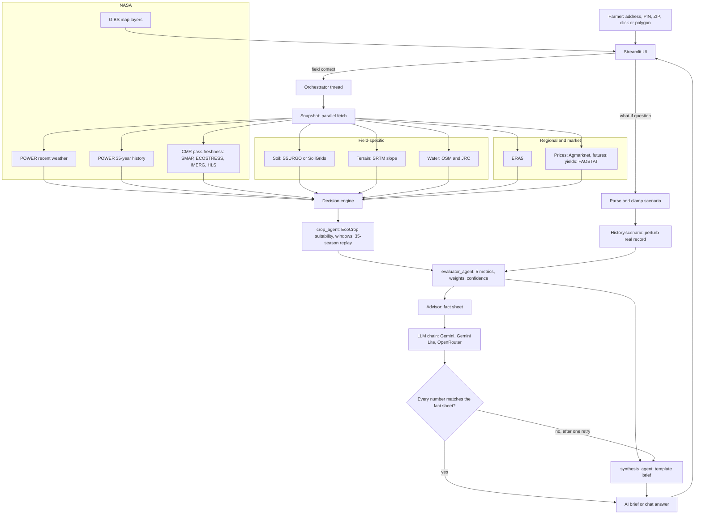

# 🛰️ FieldShift Maestro

> **Conduct your next season.** Give it an address, a PIN or ZIP code, or draw your field on a satellite map. FieldShift Maestro
> fetches live NASA and partner data for that exact spot, scores **three crop-rotation options** with visible uncertainty, and an
> **AI advisor** explains the result in plain **English or Hindi**. Ask "what if rain drops 30%?" and the options are re-scored on
> 35 years of real weather.

**Team: The Orchestrator**

**NASA Space Apps Challenge 2026 · Challenge: Field Shift: Adapting Farms with NASA Data**

*An independent entry. Not affiliated with or endorsed by NASA. No NASA logos or branding are used.*

---


## 🚀 Live Demo

**[🌐 Launch FieldShift Maestro](https://fieldshift-maestro.streamlit.app/)**

Explore the application and see how NASA Earth observation data can help farmers make climate-resilient crop rotation decisions.

## 🎥 Project Demo

<a href="https://www.youtube.com/watch?v=kQd7gz7DV5A">
  
</a>

*Click the preview to watch the full demonstration on YouTube.*

---------

## Table of contents

1. [The challenge and our answer](#1-the-challenge-and-our-answer)
2. [What the app does](#2-what-the-app-does)
3. [Architecture](#3-architecture)
4. [NASA resources used](#4-nasa-resources-used)
5. [All data sources](#5-all-data-sources)
6. [How the scoring works](#6-how-the-scoring-works)
7. [The AI advisor](#7-the-ai-advisor)
8. [Speed and resilience](#8-speed-and-resilience)
9. [Privacy and security](#9-privacy-and-security)
10. [Run it locally](#10-run-it-locally)
11. [Deploy (Streamlit Community Cloud)](#11-deploy-streamlit-community-cloud-free)
12. [Project layout and tests](#12-project-layout-and-tests)
13. [Honest limits](#13-honest-limits)
14. [AI use disclosure](#14-ai-use-disclosure)

---

## 1. The challenge and our answer

**The problem.** Farmers face weather that no longer follows the old calendar. Choosing what to plant next season is a bet, and
good decision support is out of reach for most small farms: data is scattered across agencies, hard to read, and rarely says how
sure it is.

**The challenge.** *Field Shift: Adapting Farms with NASA Data* asks teams to use NASA Earth observation data to help farms adapt.

**Our answer.** A farmer-facing decision tool that does four things:

| Principle | What it means in the app |
|---|---|
| **Live data, never invented** | Every number comes from a live source. If a source is down, that metric is left out and the confidence score drops. The screen says why. |
| **Uncertainty is visible** | Each option shows a score with a ± band, a confidence rating and a per-year stress chart across 35 seasons. |
| **The AI never makes up numbers** | The advisor gets values calculated by the app and may only quote those. Every number it writes is checked, and a plain computed summary replaces any reply that fails the check. |
| **Honest about resolution** | Rain and temperature describe the region (about 10 to 50 km). Soil, slope, nearby water and satellite imagery are specific to the field. The app labels which is which. |

It is **India-first** (PIN codes, Hindi, live mandi prices) and **global** (US soil survey detail, worldwide weather and crop data).

---

## 2. What the app does

1. **Find the farm.** Search an address, village, PIN code or ZIP, or click the map. Two one-click demos are included: farmland near
   Khanna, Punjab (India) and Ames, Iowa (USA).
2. **Mark the field.** Drop a pin (analyses a 150 m circle, about 7 ha) or draw the real boundary with the polygon or rectangle tool.
   The boundary is validated, with farmer-readable error messages.
3. **Choose the crop and priority.** Current crop (13 crops), main priority (Water, Soil or Income) and whether the field can be irrigated.
4. **Analyze.** A live activity log shows every source as it is fetched, with timings.
5. **Read the result.**
   - An instant plain-language brief, replaced by the AI advisor's note when it is ready (English or Hindi).
   - A data-status panel showing which sources answered, how fast, and which failed.
   - Field facts: soil texture, clay and sand, drainage, organic carbon, elevation, slope, nearby water and irrigation access.
   - **Three rotation options**, each with a total score, confidence, five metric bars with uncertainty, a 35-season stress chart,
     the sowing window and notes on what to verify locally.
6. **Ask what-if questions.** "What if rain drops 30%?", "What if it gets 2 degrees hotter?", "What if I can irrigate?" (also in Hindi).
   The weather record is perturbed, the options are re-scored, and the advisor explains what changed.
7. **See the satellite context.** Toggle NASA GIBS layers on the map: vegetation greenness (NDVI), soil moisture, rainfall rate and
   land surface temperature, over an Esri satellite basemap.
8. **Test the failure path.** A "Simulate NASA outage" switch shows how the app degrades when sources fail.

The three options are always chosen by rule, so they are easy to explain:

| Option | How it is picked |
|---|---|
| **Baseline** | The crop the farmer already grows. |
| **Climate-resilient** | The crop with the best 10th-percentile season over 35 years, among suitable crops from a **different plant family**. |
| **Nitrogen-fixer** | The best-suited legume, preferring deeper roots when scores are close. |

---

## 3. Architecture

### System diagram

```
                              ┌──────────────────────────────────────────────┐
                              │   FARMER  (browser, English / Hindi)         │
                              │   address · PIN · ZIP · map click · polygon  │
                              └───────────────────────┬──────────────────────┘
                                                      │
                              ┌───────────────────────▼──────────────────────┐
                              │  STREAMLIT UI  (app.py)                      │
                              │  map (folium + NASA GIBS) · cards · chat     │
                              │  session state · progressive rendering       │
                              └───────────┬───────────────────────▲──────────┘
                                          │ ctx                   │ events + result
                              ┌───────────▼───────────────────────┴──────────┐
                              │  ORCHESTRATOR  (background thread)           │
                              │  run_pipeline → streams live progress        │
                              └───────────┬──────────────────────────────────┘
                                          │
        ┌─────────────────────────────────▼─────────────────────────────────────────┐
        │  SNAPSHOT: parallel fetch, each source has a timeout, cache, circuit breaker│
        │                                                                            │
        │  NASA                         FIELD-SPECIFIC                REGIONAL       │
        │  ┌──────────────────┐         ┌────────────────────┐        ┌────────────┐ │
        │  │ POWER  recent    │         │ Soil               │        │ ERA5       │ │
        │  │ POWER  35-yr     │         │  SSURGO (US)       │        │ Open-Meteo │ │
        │  │ CMR    SMAP,     │         │  SoilGrids (world) │        └────────────┘ │
        │  │  ECOSTRESS, IMERG│         │ Terrain  SRTM      │                       │
        │  │  HLS freshness   │         │ Water  OSM + JRC   │                       │
        │  └──────────────────┘         └────────────────────┘                       │
        └─────────────────────────────────┬─────────────────────────────────────────┘
                                          │ snapshot (values + provenance tags)
        ┌─────────────────────────────────▼─────────────────────────────────────────┐
        │  DECISION ENGINE  (deterministic, no AI, no randomness)                    │
        │                                                                            │
        │  crop_agent       FAO EcoCrop suitability (13 crops) · planting windows    │
        │                   35-season stress replay · three strategy picks           │
        │  evaluator_agent  Suitability · Water · Soil · Erosion · Economics         │
        │                   weights by priority · ± band · confidence from provenance│
        │  synthesis_agent  instant template brief (always available)                │
        └──────────────┬──────────────────────────────────────────────▲─────────────┘
                       │ result (scores, history, evidence)           │ re-score
        ┌──────────────▼──────────────────────────────────────────────┴─────────────┐
        │  ADVISOR  (advisor.py)  the AI explains; the code computes                 │
        │                                                                            │
        │  fact sheet ──► LLM ──► number check (ungrounded?) ──► accept              │
        │  (no coordinates)         │  fail → regenerate once → template fallback    │
        │                           │                                                │
        │  chat:  parse question (clamped) → History.scenario() → engine re-score    │
        │         → LLM explains the new numbers                                     │
        └──────────────┬─────────────────────────────────────────────────────────────┘
                       │
        ┌──────────────▼─────────────────────────────────────────────────────────────┐
        │  LLM FALLBACK CHAIN  (llm.py)                                              │
        │  Gemini 3.5 Flash → Gemini 3.5 Flash-Lite → OpenRouter free → template     │
        │  circuit breakers · rate budgets · prompt cache · hard deadlines           │
        └────────────────────────────────────────────────────────────────────────────┘

        Cross-cutting:  SQLite TTL cache (successful lookups only)  ·  provenance tags on every input
```

### The same flow as a Mermaid diagram (renders on GitHub)



### Design decisions that shape the code

| Decision | Why |
|---|---|
| Single Streamlit app, no separate API server | One deployable unit, no network hop, simplest to host on a free Space. |
| Orchestrator runs in a background thread and streams events through a queue | The UI shows live progress instead of a frozen spinner. |
| Deterministic engine, AI only narrates | Scores are reproducible and auditable. The AI cannot change a number. |
| Provenance tag on every input (`live`, `modeled`, `reference`, `heuristic`, `missing`) | Confidence is computed from how trustworthy each input is, not guessed. |
| A failed lookup raises an error instead of returning an empty value | Failures are never cached, so they are retried. A missing metric is dropped, never filled in. |
| What-if chat uses two plain JSON calls, not native tool calling | Behaviour is identical across Gemini and OpenRouter models. |

---

## 4. NASA resources used

The challenge requires at least one NASA resource, and we list every one here. NASA data is the backbone of the weather and
climate inputs.

| NASA resource | What we use it for | How it is used |
|---|---|---|
| **NASA POWER** (daily point API) | Recent weather: rain, mean, maximum and minimum temperature, and root-zone and surface soil wetness (MERRA-2). **35-year daily history** for the field's 0.5° cell. | Drives the crop stress replay, rainfall and temperature fit, evapotranspiration (Hargreaves), planting windows and every what-if scenario. |
| **NASA CMR** (Common Metadata Repository) | Freshness of the latest **SMAP**, **ECOSTRESS**, **GPM IMERG** and **HLS** granules over the field. | Shown in the data-status panel as "how recent is satellite coverage here". |
| **NASA GIBS** (Global Imagery Browse Services) | Map layers: **MODIS NDVI** (vegetation), **SMAP** soil moisture, **GPM IMERG** rainfall rate, **MODIS** land surface temperature. | Toggleable overlays on the satellite map for visual context. |

**Precise about the satellites.** SMAP and ECOSTRESS appear as **pass freshness and map layers only**. We do not download or analyse
their pixel values, and the app never claims to. Soil moisture used in scoring comes from MERRA-2 (via POWER) or ERA5 and is labelled
*modeled*.

---

## 5. All data sources

Everything is free to use and queried live. No source is mocked.

| Source | Provides | Resolution or scope | Cache |
|---|---|---|---|
| NASA POWER | Daily weather, 35-year history | About 50 km (0.5° cell) | recent 3 h, history 30 d |
| NASA CMR | Latest SMAP, ECOSTRESS, IMERG, HLS granule time | Point query | 1 h |
| NASA GIBS | NDVI, soil moisture, rain, land temperature tiles | 250 m to 10 km, per layer | browser |
| Open-Meteo ERA5 | Independent cross-check: rain, evapotranspiration, top-soil moisture | About 10 to 25 km | 6 h |
| USDA SSURGO (Soil Data Access) | Soil texture, drainage, hydrologic group (US) | Mapped soil units | 30 d |
| ISRIC SoilGrids | Soil texture, pH, organic carbon (rest of world) | 250 m, modelled | 30 d |
| SRTM via OpenTopoData | Elevation and slope | About 30 m | 90 d |
| OpenStreetMap Overpass | Nearby rivers, canals, ponds, wells | Mapped features | 7 d |
| JRC Global Surface Water | Satellite-detected surface water | 30 m | 30 d |
| FAO EcoCrop | Crop temperature, rainfall, soil and pH requirements | Per crop | 30 d |
| FAO-56 | Crop coefficients, root depth, cycle length | Published constants | built in, cited |
| Agmarknet via data.gov.in | Live Indian mandi (wholesale market) prices | Latest day, state-level | 6 h |
| Yahoo Finance futures | Global benchmark crop prices | Global | 1 h |
| FAOSTAT via Our World in Data | National average crop yields | Country | 7 d |
| Nominatim (OpenStreetMap) | Address, PIN and ZIP geocoding, reverse lookup | Worldwide | 7 to 30 d |
| Esri World Imagery | Satellite basemap | Worldwide | browser |
| Google Gemini, OpenRouter | The AI advisor (see section 14) | Text only | prompt cache |

The only non-live inputs are published agronomy constants (FAO-56 crop coefficients, literature nitrogen-fixation ranges), each
cited in `maestro/reference.py`.

---

## 6. How the scoring works

### Crop suitability

`ecocrop.py` loads FAO EcoCrop requirements at runtime. `crops.py` scores each of the 13 crops (wheat, rice, maize, soybean,
cotton, chickpea, mung bean, cowpea, groundnut, alfalfa, sorghum, pearl millet, mustard) with a **limiting-factor rule**: a crop is
only as suitable as its worst-matching requirement (temperature, rainfall, soil texture, drainage, pH). Blank source values stay
blank and are never guessed.

### The 35-season replay

`climate.py` takes 35 years of NASA POWER daily weather for the field's cell, computes Hargreaves ET0, searches the best planting
window for each crop, and replays each of the 35 seasons to get a **stress index** (temperature fit × rain coverage, 1 = ideal). The
spread across years is what produces the uncertainty. The per-year chart on each card switches to the irrigated replay (temperature only) when the farmer says the field can be irrigated.

### Five metrics, weighted by the farmer's priority

| Metric | What it measures |
|---|---|
| **Suitability** | EcoCrop limiting-factor fit to the field's climate and soil (texture, drainage, pH). |
| **Water** | Mean rainfed season stress index over the 35-season replay. |
| **Soil** | Rotation soil-health index: 0.5 × nitrogen fixation (literature midpoint ÷ 125 kg N/ha, capped at 1) + 0.3 × plant-family break from the current crop + 0.2 × root depth (m ÷ 2, capped at 1). |
| **Erosion** | `1 − (1 − ground cover) × slope factor × rain factor`. Cover comes from the crop's growth habit, slope from SRTM, rain from the 35-year record. A rule of thumb, not a model. |
| **Economics** | Gross revenue (live price × national average yield, no costs), expressed relative to the best option that has a revenue estimate. Needs at least two options with revenue. |

| Priority | Suitability | Water | Soil | Erosion | Economics |
|---|---|---|---|---|---|
| Water | 0.25 | **0.35** | 0.15 | 0.10 | 0.15 |
| Soil | 0.25 | 0.15 | **0.35** | 0.15 | 0.10 |
| Income | 0.25 | 0.10 | 0.15 | 0.10 | **0.40** |

If a metric has no data (for example soil on a built-up pixel), its weight is **redistributed over the metrics that exist**, and
confidence drops.

### Confidence and uncertainty

Each input carries a provenance tag worth a trust weight: `live` 1.0, `reference` 0.8, `modeled` 0.7, `heuristic` 0.5, `missing`
0.2. A metric's confidence is the weighted average of its inputs, and the option's confidence is the weighted average across
metrics. The ± band shown on each bar is `0.25 × (1 − confidence)`, so less certain options visibly show wider bands. Confidence
under 0.5 is flagged "Low, verify locally".

### Economics, honestly

Revenue exists only where a **live price and a free national yield series both exist**: wheat, rice, maize and soybean. In India,
Agmarknet gives the live mandi price (falling back to an all-India median when a state has no arrivals that day, and saying so).
Other crops show the live price without a revenue estimate, and cowpea and alfalfa have no free price source.

---

## 7. The AI advisor

The advisor is built on one rule: **the LLM never produces numbers.**

### The brief

1. The app builds a compact **fact sheet** of calculated values for the three options. It contains the state and country name but
   **no coordinates, names or addresses**.
2. The LLM writes a plain-language brief in English or Hindi from that sheet only.
3. **Every number in the reply is extracted and checked** against the fact sheet. Rounding to the written precision is tolerated;
   Devanagari digits are normalised. Anything else is rejected.
4. On a failed check the advisor **regenerates once**, naming the offending numbers. If it fails again, the **template summary is
   shown instead**, and the screen says which one you are reading.

### What-if chat

1. **Call 1** turns the question into scenario settings (JSON): rain change, temperature change, irrigation, current crop, priority.
   Values are **clamped in code** (rain −60 to +60 %, temperature −3 to +6 °C). A regex parser takes over if no LLM is available.
2. `History.scenario()` scales every day of the **real 35-year record** (rain × factor, temperature + shift, ET0 recomputed). This
   replays the past under a change. It is **not a forecast**, and the answer says so.
3. The engine **re-scores** the options on the perturbed history.
4. **Call 2** explains the new numbers using a fact sheet that includes the before and after, and whether the best option changed.
5. Off-topic questions get a fixed reply and cost no second call.
6. Numbers typed by the farmer are **not trusted**, which blocks prompt injection such as "promise 5000 kg".

### The LLM fallback chain (`llm.py`)

```
Gemini 3.5 Flash ─► Gemini 3.5 Flash-Lite ─► OpenRouter free model 1 ─► OpenRouter free model 2 ─► computed template
```

Free tiers fail often, so each endpoint has:

- a **circuit breaker** (cooldown on rate limits using the provider's retry hint, exponential backoff on transient errors, disabled on auth errors);
- local **per-minute and per-day budgets**;
- a **prompt-hash cache**;
- **JSON-mode validation** that falls through on bad output without penalising the endpoint;
- **truncation detection** (a cut-off answer moves to the next endpoint);
- a **hard wall-clock deadline** per request and per chain call, because HTTP timeouts reset on every byte and some free providers drip keep-alive bytes.

The free Gemini main model hits its quota quickly, so most answers come from the Flash-Lite tier. That is the chain working as designed.

---

## 8. Speed and resilience

| Situation | Typical time |
|---|---|
| Cold analysis (nothing cached) | 4 to 8 s, up to about 12 s when public APIs lag |
| Warm analysis (cached) | under 2 s |
| AI chat turn | 5 to 10 s |

How it stays fast and does not hang:

- All field sources are fetched **in parallel**, each with its own timeout.
- **SQLite TTL cache** with per-source lifetimes (table above). Only successful results are cached, so failures retry.
- Coordinates **snap to the 0.5° weather cell**, so nearby farms share one cached history.
- The **Punjab demo field is pre-fetched** in a background thread at server start.
- **Circuit breakers** skip a source that just failed (for example public Overpass servers, which are often at capacity, fall back to JRC satellite water detection).
- **Progressive UI**: the template brief appears immediately and the AI brief swaps in when ready. The chat is a Streamlit fragment, so it never re-runs the page.

---

## 9. Privacy and security

- **API keys** live only in a local `.env` (gitignored) and, on the host, in **Streamlit secrets**. They are never printed, logged
  or committed. The UI shows keys masked only.
- **What the AI provider sees:** field-level numbers plus the state and country name. **No coordinates, names or addresses.** The
  app says this next to the chat box. Free-tier providers may use prompts to improve their services.
- **Prompt-injection guard:** numbers the user types are not trusted in AI answers (section 7).
- **No accounts, no tracking**, and Streamlit usage statistics are switched off.
- The optional Docker image runs as a **non-root user**.

---

## 10. Run it locally

You need Python 3.12.

```bash
python -m venv .venv
.venv/Scripts/activate                 # Windows. On macOS or Linux: source .venv/bin/activate
pip install -r requirements-dev.txt
cp .env.example .env                   # then add your free keys (below)
streamlit run app.py                   # opens http://localhost:8501
pytest -q tests                        # 72 tests, no network needed
```

**Keys** (all optional; the app degrades gracefully without them):

| Variable | Used for | Where to get it (free) |
|---|---|---|
| `GEMINI_API_KEY` | AI advisor | https://aistudio.google.com |
| `OPENROUTER_API_KEY` | AI fallback | https://openrouter.ai/keys |
| `DATA_GOV_IN_API_KEY` | Live Indian mandi prices | https://data.gov.in (register, then My Account) |

With no keys the app still works: the AI advisor is replaced by the computed summary, and Indian prices are skipped.

To check that your keys and the fallback chain work against the real providers: `python -m maestro.check_keys`.

**Troubleshooting**

- *"The app was updated while this page was open"*: that message means the page holds a result from an older version of the code.
  Refresh the browser tab and press **Analyze field** again.
- *Changes to `maestro/*.py` do not show up*: a Streamlit server that has been running a long time may hold old modules. Stop it
  (Ctrl+C) and start it again. Locally the file watcher is on, so edits normally reload on their own.
- *Soil shows "not available"*: SoilGrids has no data on built-up pixels. Click a farm field, not a town centre.

---

## 11. Deploy (Streamlit Community Cloud, free)

The live demo runs on **Streamlit Community Cloud**, deployed straight from this GitHub repo:

1. Sign in at [share.streamlit.io](https://share.streamlit.io) with GitHub and choose **Create app**.
2. Pick this repository, branch `main`, main file `app.py`.
3. In **Advanced settings**, choose Python 3.12 and paste the keys under **Secrets** (TOML):
   `GEMINI_API_KEY`, `OPENROUTER_API_KEY`, `DATA_GOV_IN_API_KEY`. Top-level secrets are exposed as environment variables, which is
   what `maestro/config.py` reads, so no code change is needed.
4. Deploy. Every push to `main` redeploys the app.

Free apps sleep when idle and take about 30 seconds to wake. The cache directory is set by `CACHE_DIR` and falls back to memory
if the disk is not writable, so the first analysis after a restart is slower.

**Other hosts.** The repo also contains a `Dockerfile` (port 8501, non-root user, health check) for any container host. Hugging Face
Docker Spaces were not used because they are no longer free.

---

## 12. Project layout and tests

```
app.py                  Streamlit UI: map, cards, live log, chat, disclosure
maestro/
  orchestrator.py       background-thread pipeline that streams progress events
  snapshot.py           parallel fetch of all field sources with per-source status
  nasa.py               NASA POWER and CMR clients
  gibs.py               NASA GIBS layer table and tile URLs
  geo.py                geocoding, field geometry, validation, region tier
  providers.py          soil (SSURGO, SoilGrids), terrain, water (OSM, JRC), ERA5
  climate.py            35-year history, Hargreaves ET0, planting windows, season replay, scenarios
  ecocrop.py            FAO EcoCrop loader and fit functions
  crops.py              suitability and the three strategy picks
  markets.py            Agmarknet, futures, FAOSTAT yields, economics
  evaluate.py           crop, evaluator and synthesis agents; weights and confidence
  advisor.py            fact sheet, number grounding, brief, scenario parsing and chat
  llm.py                provider fallback chain, breakers, budgets, deadlines
  reference.py          cited crop constants (the only non-live data)
  cache.py, http.py, config.py, check_keys.py
tests/                  72 tests: crop engine, geo providers, LLM chain, advisor, app smoke
Dockerfile, requirements.txt, .streamlit/config.toml
```

**Tests** (`pytest -q tests`) cover the crop engine, geocoding and field providers, LLM chain behaviour (rate limits, truncation,
slow providers, gzip, deadlines, using mocked HTTP), the advisor's number checking and scenario engine, and an app smoke test. The
tests mock the network only to test failure handling. The app itself uses no mocked data.

---

## 13. Honest limits

- **Regional weather.** Rain and temperature are about 10 to 50 km resolution. They describe your region, not your field.
- **Not a yield forecast.** Scores are a transparent limiting-factor index. What-if scenarios replay the past under a change.
- **Economics is partial.** Revenue is gross (no costs) and exists only for wheat, rice, maize and soybean. Futures are global
  benchmarks, not farm-gate prices. Agmarknet reflects the latest day's arrivals only.
- **Planting windows are indicative**, derived from climate fit, not a local calendar.
- **Soil on built-up pixels is poor.** SoilGrids is modelled and slow (3 to 13 s cold). Click a farm field.
- **Satellite use is context, not analysis.** SMAP and ECOSTRESS are pass freshness and map layers only.
- **Free AI tiers are rate limited.** Expect the lighter Gemini model to answer most of the time, and the computed summary when all providers are busy.
- Always check locally with an agronomist before acting.

---

## 14. AI use disclosure

- **In the app:** the advisor brief and what-if answers are written by **Google Gemini** (free tier), with **OpenRouter** free models as
  a fallback. The AI never produces numbers: it receives calculated values, and every number in its reply is checked against them.
- **What is sent:** field-level numbers and the state and country name only. No name, address or coordinates. Free-tier providers
  may use prompts to improve their services.
- **In the code:** large parts of this code were written with an AI coding assistant (**Claude Code**), and checked with an automated test suite (72 tests).
- **In this document:** this README was drafted with AI assistance.
- The app contains **no AI-generated images or video**.

---

**Team: The Orchestrator · NASA Space Apps Challenge 2026 · Challenge: Field Shift: Adapting Farms with NASA Data**

*Data courtesy of NASA POWER, CMR and GIBS, and the open-data providers listed in section 5.*
